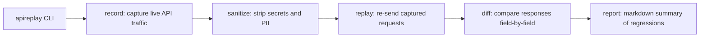

# APIReplay

**Reproduce backend bugs without production access.**

Debugging a regression against production usually means one of two bad
options: replaying traffic against prod (risky), or hand-writing curl
commands from memory (lossy). APIReplay gives you a third option —
capture real HTTP traffic once, sanitize out every secret, then replay it
against your local service any number of times and get a precise diff of
what changed: status codes, response bodies, headers, and latency.

Zero third-party dependencies. Python 3.10+. Standard library only.

## The loop

```
record    capture traffic -> replay pack (HAR import or live proxy)
sanitize  redact secrets/PII from the pack (headers, query params, bodies)
replay    fire the pack at a local service, concurrently, with timing
diff      compare recorded vs replayed: status, body, headers, latency
report    Markdown or self-contained HTML report of every mismatch
```

## 5-minute quickstart

```bash
git clone https://github.com/BhagyashriT/apireplay.git && cd apireplay
bash demo/run.sh
# Demo complete — report: demo/report.md
```

The demo spins up a v1 service, records 7 requests through the capture
proxy, sanitizes the pack, replays it against a v2 service that seeds
**3 regressions** (a 422→400 status change, a `full_name`→`name` field
rename, and a ~50 ms→~600 ms latency regression), and writes
`demo/report.md` showing all three caught. See `demo/README.md`.

## Command reference

```bash
# Capture
apireplay record --from-har traffic.har --out pack.json
apireplay record --proxy --port 8888 --target http://localhost:8080 --out pack.json
#   (send traffic through 127.0.0.1:8888, Ctrl-C to save the pack)

# Redact (prints counts per category, never values)
apireplay sanitize pack.json --out clean.json [--rules rules.json]

# Replay
apireplay replay clean.json --target http://localhost:8080 \
    --workers 8 --timeout 10 --out results.json

# Compare
apireplay diff clean.json results.json --out diff.json \
    [--ignore created_at --ignore "items[*].updated_at"] \
    [--unordered-lists] [--latency-threshold-ms 200] [--latency-ratio 2.0]

# Report
apireplay report diff.json --format md --out report.md     # or --format html
```

Every command also runs as `python -m apireplay <command>`.

## Pack format

A pack is versioned JSON (`"format": "apireplay/v1"`) so old packs stay
readable as the tool evolves:

```json
{
  "format": "apireplay/v1",
  "created_at": "2026-10-16T19:00:00+00:00",
  "source": "har",
  "requests": [
    {
      "id": "req-0001",
      "method": "GET",
      "url": "http://localhost:8080/api/users/1",
      "path": "/api/users/1",
      "query": {"verbose": "true"},
      "headers": {"accept": "application/json"},
      "body": "",
      "recorded_response": {
        "status": 200,
        "headers": {"content-type": "application/json"},
        "body": "{\"id\": 1}",
        "latency_ms": 12.4
      }
    }
  ]
}
```

Bodies are UTF-8 strings; non-UTF-8 bytes are stored base64 with
`"body_encoding": "base64"`. `diff.json` additionally embeds the recorded
and replayed response snapshots on every failing request, so it is a
self-contained artifact — `apireplay report` needs nothing else.

## Sanitization rules

Built-in defaults (extendable via `--rules rules.json`):

| Surface      | Redacted                                                    |
|--------------|-------------------------------------------------------------|
| Headers      | `authorization`, `proxy-authorization`, `cookie`, `set-cookie`, `x-api-key`, `x-auth-token` (case-insensitive) |
| Query params | `token`, `api_key`, `apikey`, `secret`, `password`, `access_token`, `client_secret` |
| Body values  | emails, credit-card-like numbers (13–19 digits), SSN-like `NNN-NN-NNNN`, `Bearer` tokens, `AKIA…` keys, `sk-…` secrets — recursive over JSON, regex fallback on raw text |

Custom rules JSON:

```json
{
  "headers": ["x-internal-token"],
  "query_params": ["session_id"],
  "body_patterns": [{"name": "internal_id", "regex": "INT-[0-9]{6}"}]
}
```

## Design notes

- **Semantic body diff, not string diff.** Object key order is ignored,
  numeric `1` equals `1.0`, and `--ignore` dot-paths with `*` wildcards
  (e.g. `items[*].updated_at`) skip volatile fields like timestamps and
  request IDs — the #1 source of false positives in replay testing.
- **Latency is a signal, not a boolean.** A replay is flagged only when it
  exceeds *both* an absolute (`+200 ms`) and a relative (`×2.0`) bound,
  and the report shows p50/p95 for both runs so you can judge noise vs
  regression yourself.
- **Errors are verdicts.** Timeouts and connection failures become
  `FAIL` with a reason instead of crashing the run.
- **Packs are the contract.** Record once, sanitize once, replay anywhere:
  CI, a teammate's laptop, or against last week's build.

## Limitations (v1)

- The capture proxy is **HTTP only** — no TLS interception, so no HTTPS
  capture. Import HTTPS traffic via `--from-har` instead.
- The proxy forwards to a single `--target` origin; it is a recording aid,
  not a general-purpose proxy.
- Sanitizer patterns are heuristic (e.g. long digit runs); review the
  redaction counts before sharing a pack.

## Roadmap

- HAR export of replayed runs for before/after sharing
- Request templating (per-replay variable substitution, e.g. hostnames)
- JUnit XML output for CI integration
- gRPC / WebSocket capture

## Development

```bash
pip install -e .
python -m unittest discover -s tests -v
bash demo/run.sh
```

CI runs the suite on Python 3.10 / 3.11 / 3.12.

## License

MIT — see [LICENSE](LICENSE).

## Architecture



## Design trade-offs

- **Stdlib only, zero dependencies** — installs anywhere, including locked-down CI runners, with a plain `pip install`. The cost: no `click`/`typer` niceties; `argparse` does the job.
- **File-based recordings, not a database** — recordings are plain files you can diff, grep, and check into git next to the code they test. A SQLite store would query better but adds a format nobody can read without the tool.
- **Synchronous replay** — deterministic ordering makes diffs trustworthy. Parallel replay would be faster for large suites but makes timing-related diffs flaky, and speed wasn't the bottleneck being solved.

## Known limitations

- Latency comparisons are wall-clock and environment-sensitive — the 50ms→600ms regression in the demo is deliberately exaggerated; real thresholds need per-environment calibration.
- 49 tests green; CI runs on Python 3.10 / 3.11 / 3.12.
